# ЛАБОРАТОРНАЯ РАБОТА №4: ФАЙЛЫ TXT/CSV И ОТЧЁТЫ ПО ТЕКСТОВОЙ СТАТИСТИКЕ

## ЗАДАНИЕ A:

### ФУНКЦИЯ 1: read_text — чтение текстового файла

Принимаем путь к файлу и его кодировку. Через `open` открываем файл
на чтение, а методом `read` получаем всё содержимое одной строкой.
Используем `with`, чтобы файл автоматически закрылся после чтения.

По умолчанию выбираем UTF-8. Если файл сохранён в другой кодировке,
передаём её через параметр `encoding`, например `encoding="cp1251"`.

Для пустого файла возвращаем пустую строку. Если файл отсутствует,
возникает `FileNotFoundError`. Если кодировка не подходит —
`UnicodeDecodeError`. Эти исключения внутри функции не перехватываются.

В этой работе читаем файл целиком. Для очень больших файлов лучше использовать 
построчное чтение, чтобы не хранить весь текст в памяти.

### ФУНКЦИЯ 2: ensure_parent_dir — создание родительских папок

Преобразуем переданный путь в объект `Path`. Через свойство `parent`
получаем папку, в которой должен находиться файл, и вызываем `mkdir`.

Параметр `parents=True` позволяет создать все недостающие папки
в указанном пути. Параметр `exist_ok=True` позволяет продолжить работу,
если папка уже существует.

Функция ничего не возвращает. Вызываем её перед записью CSV.

### ФУНКЦИЯ 3: write_csv — запись таблицы в CSV

Принимаем список строк, путь к выходному файлу и необязательный заголовок.

Сначала проверяем данные. Если список не пустой, запоминаем длину
первой строки в переменной `exlength`. Затем перебираем все строки
и сравниваем их длину с первой. Если длины различаются,
вызываем `ValueError`.

Отдельно проверяем заголовок, если он передан.
Количество его элементов должно совпадать с количеством столбцов данных.

Все проверки выполняем до открытия файла на запись.
Поэтому при неправильных данных старое содержимое файла сохраняется.

После проверки создаём родительские папки и открываем файл
в режиме `"w"` с кодировкой UTF-8 и параметром `newline=""`.
Существующий файл при успешной записи перезаписывается.

Для записи используем `csv.writer` с разделителем-запятой.
Сначала записываем заголовок, затем циклом проходим по строкам данных.

Для пустого списка предусмотрены два случая:

- если заголовка нет, создаём пустой файл;
- если заголовок передан, записываем только его.

### Проверка функций

Читаем подготовленный входной файл:

```bash
python3 -c "from src.lab04.io_txt_csv import read_text; print(read_text('data/lab04/input.txt'))"
```
Получаем:
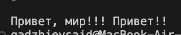

Проверяем запись CSV:

```bash
python3 -c "from src.lab04.io_txt_csv import write_csv; write_csv([('Привет', 3)], 'data/lab04/check.csv', header=('word', 'count'))"
```

В `data/lab04/check.csv` получаем:

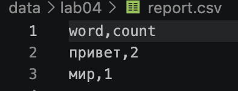

Проверяем пустой список без заголовка:

```bash
python3 -c "from src.lab04.io_txt_csv import write_csv; write_csv([], 'data/lab04/check_empty.csv')"
```

Получаем пустой файл:
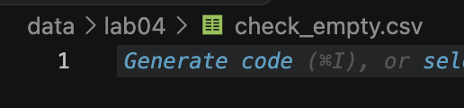

Проверяем пустой список с заголовком:

```bash
python3 -c "from src.lab04.io_txt_csv import write_csv; write_csv([], 'data/lab04/check_header.csv', header=('word', 'count'))"
```

Получаем файл только с заголовком `word,count`:
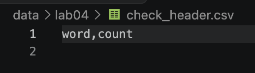

Проверяем строки разной длины:

```bash
python3 -c "from src.lab04.io_txt_csv import write_csv; write_csv([('кот', 2), ('дом',)], 'data/lab04/check.csv')"
```
Получаем:
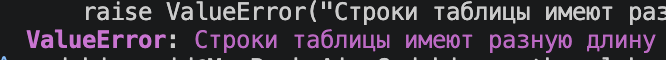


Проверяем несовпадение длины заголовка:

```bash
python3 -c "from src.lab04.io_txt_csv import write_csv; write_csv([('кот', 2)], 'data/lab04/check.csv', header=('word',))"
```

Возникает `ValueError`: в строке данных два элемента,
а в заголовке только один.

Получаем:


---

## ЗАДАНИЕ B: ГЕНЕРАЦИЯ ОТЧЁТА text_report.py

Читаем входной файл через `read_text`. Затем используем функции
из третьей лабораторной: нормализуем текст через `normalize`,
разбиваем его на слова через `tokenize` и считаем частоты через `count_freq`.

Через `len(tokens)` получаем общее количество слов,
а через `len(freq)` — количество уникальных.
Для записи всех слов вызываем `top_n(freq, unique_words)`.
Полученные пары передаём в `write_csv` с заголовком `word,count`.

В отчёте сначала идут слова с большей частотой.
При одинаковой частоте сортируем слова по алфавиту.
В консоль отдельно выводим топ-5 через `top_n(freq, 5)`.

Без дополнительных параметров программа читает
`data/lab04/input.txt` и сохраняет отчёт в `data/lab04/report.csv`.
Для чтения используется кодировка UTF-8.

При необходимости через `--in` указываем другой входной файл,
через `--out` — путь к отчёту, а через `--encoding` — кодировку.

---

### Краевые случаи


### Тест №1: Отсутствующий файл

Передаём путь к файлу, которого нет:

```bash
python3 -m src.lab04.text_report --in data/lab04/missing.txt
```

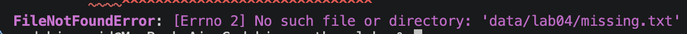

При отсутствии входного файла возникает `FileNotFoundError`.

---

### Тест №2: Неправильная кодировка

Пробуем прочитать подготовленный файл cp1251 как UTF-8:

```bash
python3 -m src.lab04.text_report --in data/lab04/cp1251.txt --encoding utf-8
```


Возникает `UnicodeDecodeError`.

Ошибки чтения в этой реализации не перехватываем:
в консоли появляется traceback, программа завершается
с ненулевым кодом.

Поскольку чтение выполняется до записи CSV,
при таких ошибках существующий отчёт не перезаписывается.


### Тест №1: Обычный текст

В файл `data/lab04/input.txt` записываем:

```text
Привет, мир! Привет!!!
```

Запускаем программу без дополнительных параметров:

```bash
python3 -m src.lab04.text_report
```

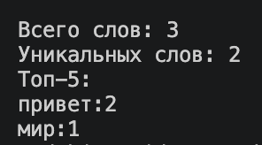

Открываем созданный `data/lab04/report.csv`:

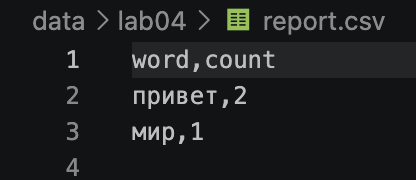

---

### Тест №2: Пустой файл

Создаём пустой файл `data/lab04/empty.txt`.
При запуске указываем отдельный путь для отчёта:

```bash
python3 -m src.lab04.text_report --in data/lab04/empty.txt --out data/lab04/report_empty.csv
```

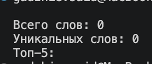

Открываем `data/lab04/report_empty.csv`:

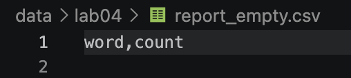

Для пустого входа сохраняем CSV только с заголовком `word,count`,
без строк данных.

---

### Тест №3: Файл в кодировке cp1251

Создаём файл `data/lab04/cp1251.txt` со словом `Привет`
и сохраняем его в cp1251:

```bash
python3 -c "from pathlib import Path; Path('data/lab04/cp1251.txt').write_bytes('Привет'.encode('cp1251'))"
```
Передаём нужную кодировку через `--encoding`:

```bash
python3 -m src.lab04.text_report --in data/lab04/cp1251.txt --encoding cp1251 --out data/lab04/report_cp1251.csv
```

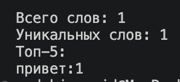

Открываем `data/lab04/report_cp1251.csv`:

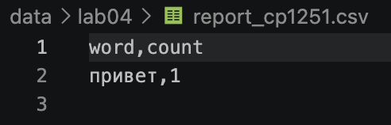

Параметр `--encoding` относится только к входному файлу.
Выходной CSV всегда записываем в UTF-8.

---
