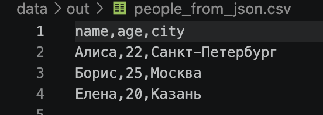
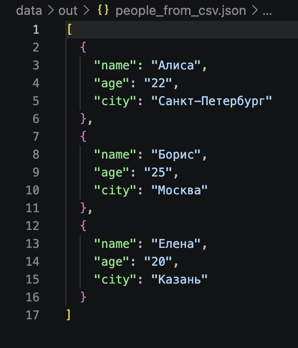
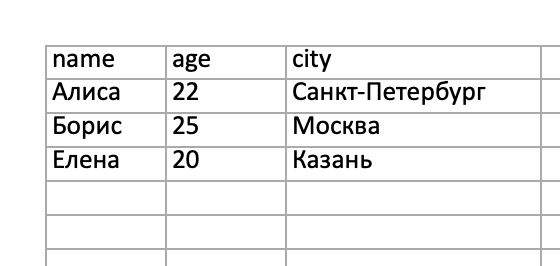
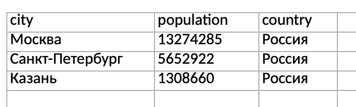

# ЛАБОРАТОРНАЯ РАБОТА №5: JSON И КОНВЕРТАЦИИ

## ЗАПУСК

```bash
python3 -m pip install -r requirements.txt
python3 -m src.lab05.demo
```

В `demo.py` находятся четыре вызова: JSON→CSV, CSV→JSON и CSV→XLSX для `people.csv` и `cities.csv`.
Результаты сохраняются в `data/out/`, папка создаётся автоматически.

## ЗАДАНИЕ A: JSON ↔ CSV

### JSON → CSV

`json_to_csv` принимает пути к JSON и выходному CSV. Проверяем данные и собираем названия колонок из ключей словарей, затем записываем таблицу. Колонки идут по порядку появления ключей, пропущенные поля оставляем пустыми.

```python
json_to_csv("data/samples/people.json", "data/out/people_from_json.csv")
```

В `people_from_json.csv` проверяем заголовок и количество строк данных.



### CSV → JSON

`csv_to_json` принимает пути к CSV и выходному JSON. Первая строка задаёт названия полей, остальные записи становятся JSON-объектами. Все значения сохраняются строками, русские буквы — напрямую, отступ — 2 пробела.

```python
csv_to_json("data/samples/people.csv", "data/out/people_from_csv.json")
```

В `people_from_csv.json` проверяем ключи и количество объектов.



## ЗАДАНИЕ B: CSV → XLSX

`csv_to_xlsx` переносит CSV в Excel через `openpyxl`. Проверяем строки, подбираем ширины колонок и записываем таблицу на лист `Sheet1`. Ширина равна длине самого длинного текста плюс 2, минимум — 8. Ячейки сохраняем как текст.

```python
csv_to_xlsx("data/samples/people.csv", "data/out/people.xlsx")
csv_to_xlsx("data/samples/cities.csv", "data/out/cities.xlsx")
```

Открываем `people.xlsx` и `cities.xlsx` в Excel или LibreOffice. Проверяем данные, лист `Sheet1` и ширины колонок.





## ФОРМАТЫ И ПРОВЕРКИ

- Кодировка — UTF-8, разделитель CSV — запятая; пути в примерах относительные.
- Пустые файлы, неверные расширения и структура → `ValueError`; отсутствующий входной файл → `FileNotFoundError`.
- Заголовок CSV проверяем на пустые и повторяющиеся имена, строки — на совпадение числа полей. Первая строка считается заголовком по соглашению. CSV только с заголовком допустим.
- Вложенные списки и словари в JSON отклоняем. `null` и отсутствующее поле становятся пустой ячейкой; исходные типы при обратной конвертации не восстанавливаются.
- Файлы читаем по частям: сначала проверяем данные, затем читаем повторно и записываем результат. Исходный файл между проходами не должен изменяться. Память зависит от размера отдельной записи и числа колонок.