# ЛАБОРАТОРНАЯ РАБОТА №6: CLI-УТИЛИТЫ С ARGPARSE

## ЗАПУСК

```bash
python3 -m pip install -r requirements.txt
python3 -m src.lab06.cli_text --help
python3 -m src.lab06.cli_convert --help
```

В `cli_text.py` находятся команды `cat` и `stats`.
В `cli_convert.py` — `json2csv`, `csv2json` и `csv2xlsx`.

Используем готовые функции из прошлых лабораторных. Для создания XLSX сохраняем `openpyxl` из ЛР5.

## ЗАДАНИЕ A: ВЫВОД ФАЙЛА И СТАТИСТИКА СЛОВ

Через `ArgumentParser` создаём парсер аргументов. Методом `add_subparsers` добавляем выбор подкоманды и делаем его
обязательным через `required=True`. Название выбранной команды сохраняем в `args.command`.

### ФУНКЦИЯ 1: positive_int — проверка параметра --top

Принимаем строку и преобразуем её в целое число через `int`. Если преобразование 
невозможно, вызываем `ArgumentTypeError` с сообщением «ожидалось целое число».

Отдельно проверяем, что число больше нуля. Ноль и отрицательные значения отклоняем.
После проверки возвращаем число. Функцию передаём в `type` при добавлении параметра `--top`.

### ФУНКЦИЯ 2: cat_file — вывод содержимого файла

Принимаем путь к файлу и параметр `numbered`. Открываем файл в UTF-8 через `with`, 
чтобы он автоматически закрылся после чтения. Перебираем файл построчно.

Через `enumerate(file, start=1)` получаем номер и содержимое строки. Если `numbered=True`, 
сначала выводим номер и табуляцию. Затем печатаем саму строку с `end=""`, чтобы не добавлять лишний
перевод строки. По умолчанию нумерация выключена.

### ФУНКЦИЯ 3: print_stats — статистика слов

Читаем файл целиком через `read_text`. Затем используем функции из третьей лабораторной: 
нормализуем текст через `normalize`, выделяем слова через `tokenize` и считаем частоты через `count_freq`.

Через `len(tokens)` получаем общее количество слов, а через `len(frequencies)` — количество уникальных.
Для вывода самых частых слов вызываем `top_n(frequencies, n=top)`.При одинаковой частоте слова идут по алфавиту.

Количество слов в топе задаём через `--top`. По умолчанию выводим топ-5. Если разных слов меньше,
выводим только имеющиеся.

### Проверка команды cat

Выводим CSV без нумерации:

```bash
python3 -m src.lab06.cli_text cat --input data/lab06/samples/people.csv
```

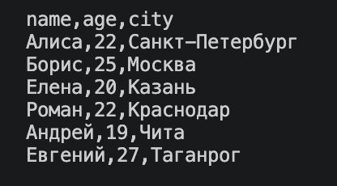

Для нумерации добавляем флаг `-n`:

```bash
python3 -m src.lab06.cli_text cat --input data/lab06/samples/people.csv -n
```

Получаем строки с номерами, начиная с 1:

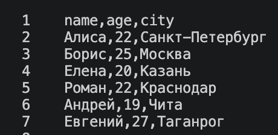

### Проверка команды stats

Запускаем программу:

```bash
python3 -m src.lab06.cli_text stats --input data/lab06/samples/people.txt --top 5
```

Получаем:

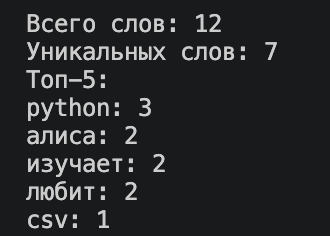

## ЗАДАНИЕ B: CLI ДЛЯ КОНВЕРТЕРОВ

В словаре `converters` связываем название каждой подкоманд с функцией ЛР5 и описанием для справки. 
В цикле добавляем обязательные параметры `--in` и `--out`. Через `dest` сохраняем пути в `args.input` и `args.output`.
Для каждой подкоманды вызываем `set_defaults(handler=function)`. После разбора аргументов 
запускаем выбранный конвертер через `args.handler(args.input, args.output)`.
Результаты сохраняем в `data/lab06/out`, отдельно от прошлых работ. Папка создаётся автоматически функциями конвертации.
Существующий выходной файл при повторном запуске перезаписывается.

### JSON → CSV

Вызываем `json_to_csv` из ЛР5 через подкоманду `json2csv`:

```bash
python3 -m src.lab06.cli_convert json2csv --in data/lab06/samples/people.json --out data/lab06/out/people_from_json.csv
```

В `people_from_json.csv` проверяем заголовок и количество строк данных.

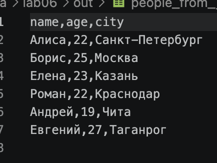

### CSV → JSON

Вызываем `csv_to_json` через подкоманду `csv2json`:

```bash
python3 -m src.lab06.cli_convert csv2json --in data/lab06/samples/people.csv --out data/lab06/out/people_from_csv.json
```

В `people_from_csv.json` проверяем ключи и количество объектов.
Все значения сохраняются строками, как в реализации ЛР5.

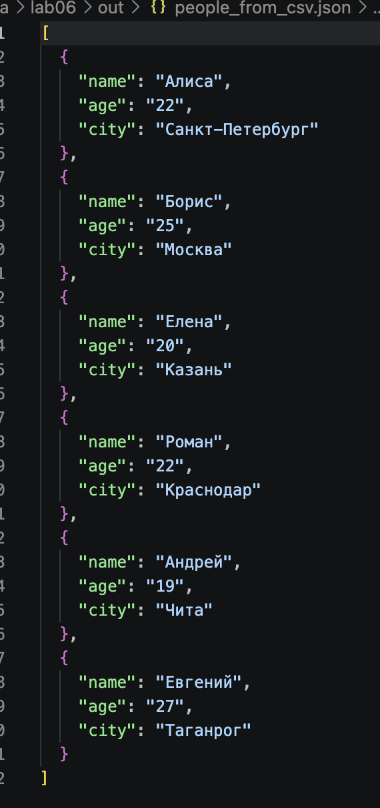

### CSV → XLSX

Вызываем `csv_to_xlsx` через подкоманду `csv2xlsx`:

```bash
python3 -m src.lab06.cli_convert csv2xlsx --in data/lab06/samples/people.csv --out data/lab06/out/people.xlsx
```

Открываем `people.xlsx` в Excel или LibreOffice. Проверяем данные, лист 
`Sheet1` и ширины колонок. Ячейки сохраняются как текст, используется `openpyxl`.

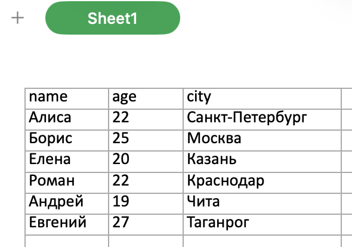

## СПРАВКА

Для каждой подкоманды проверяем `--help`:

```bash
python3 -m src.lab06.cli_text cat --help
python3 -m src.lab06.cli_text stats --help
python3 -m src.lab06.cli_convert json2csv --help
python3 -m src.lab06.cli_convert csv2json --help
python3 -m src.lab06.cli_convert csv2xlsx --help
```

Справка создаётся автоматически средствами `argparse`.
В ней выводятся параметры и их описания.
Входной файл для вывода справки не требуется.

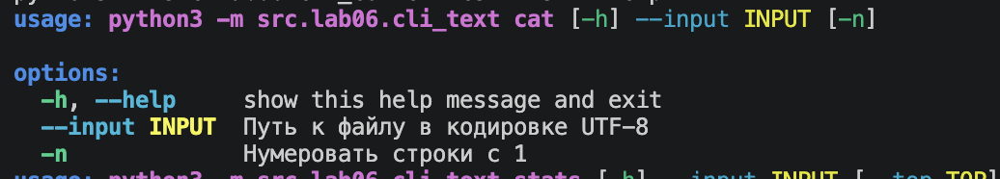
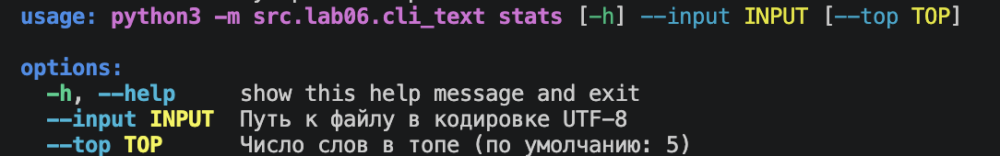
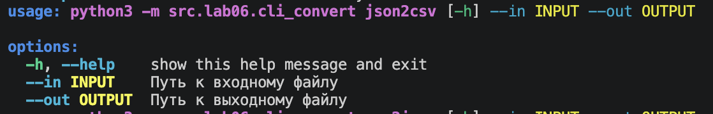
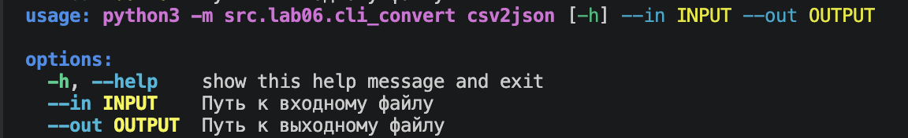
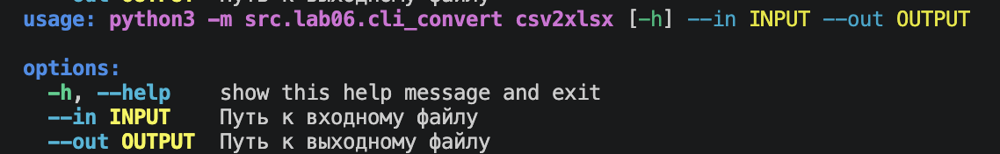

## КРАЕВЫЕ СЛУЧАИ

### Тест №1: Отсутствующий файл

Передаём путь к файлу, которого нет:

```bash
python3 -m src.lab06.cli_text cat --input missing.txt
```

При чтении возникает `FileNotFoundError`. Перехватываем его и 
вызываем `parser.error` с сообщением «Входной файл не найден».

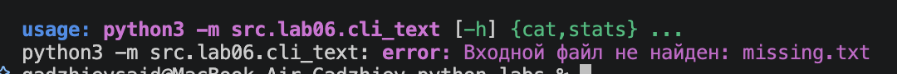

### Тест №2: Неправильное значение --top

Передаём ноль:

```bash
python3 -m src.lab06.cli_text stats --input data/lab06/samples/people.txt --top 0
```

Получаем сообщение «число должно быть больше нуля».
Для нечислового значения получаем «ожидалось целое число».

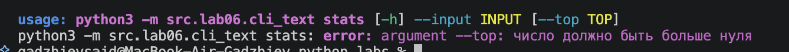

### Тест №3: Отсутствующий обязательный параметр

Запускаем конвертер без `--out`:

```bash
python3 -m src.lab06.cli_convert csv2json --in data/lab06/samples/people.csv
```

`argparse` сообщает, что параметр `--out` обязателен.
Функция конвертации не вызывается.

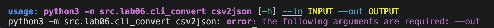

### Тест №4: Одинаковые пути

Указываем один и тот же путь для входа и выхода:

```bash
python3 -m src.lab06.cli_convert csv2json --in data/lab06/samples/people.csv --out data/lab06/samples/people.csv
```

Перед вызовом конвертера сравниваем пути через `resolve`. Если они совпадают, выводим сообщение
«Входной и выходной пути должны различаться». Конвертацию не выполняем.

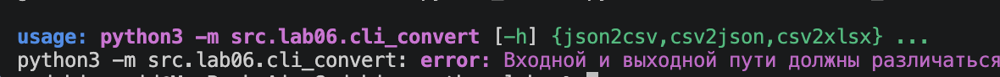

## ФОРМАТЫ И ПРОВЕРКИ

- Кодировка текстовых файлов — UTF-8, разделитель CSV — запятая; пути в примерах относительные.
- Подкоманда и входной путь обязательны. Для конвертеров также обязателен выходной путь.
- Параметр `--top` принимает только целые числа больше нуля; по умолчанию — 5.
- Ошибки аргументов обрабатывает `argparse`. Ошибки чтения, кодировки и данных перехватываем через `try/except` и выводим через `parser.error`.
- При ошибке сообщение идёт в stderr, код завершения — 2. При успешном выполнении и выводе справки — 0.
- Проверки JSON, CSV и XLSX выполняются существующими функциями ЛР5. Исходные типы значений при преобразовании CSV → JSON не восстанавливаются.