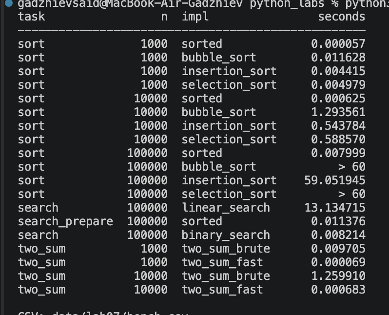

# ЛАБОРАТОРНАЯ РАБОТА №7 — ПОИСК, СОРТИРОВКА И ИЗМЕРЕНИЕ ВРЕМЕНИ

## Запуск

Из корня репозитория `python_labs` выполняем команды:

```bash
python3 -m src.lab07.check
python3 -m src.lab07.bench
```

## Задание A — поиск и Two Sum

### `linear_search`

`enumerate(nums)` даёт пары «индекс и значение», начиная с нуля. Сравниваем
каждое значение с `x` и на первом совпадении выполняем `return index`.
Например, в `[4, 2, 7, 2]` число `2` встречается дважды, а функция сразу
возвращает `1`. Если цикл закончился, возвращаем `-1`. Для `[]` цикл вообще
пропускается. В худшем случае просматриваем `n` элементов, это `O(n)` времени.

### `binary_search`

`lo = 0` и `hi = len(sorted_nums) - 1` задают включительные границы. Условие
`lo <= hi` оставляет в поиске последний элемент, когда границы равны.
Выражение `(lo + hi) // 2` даёт целый индекс середины. Если значение в середине
меньше `x`, все элементы слева от него и оно само тоже меньше `x`. Поэтому
ставим `lo = mid + 1`. Если значение больше `x`, ставим `hi = mid - 1`.
При равенстве сразу возвращаем `mid`. Для пустого списка начальные границы
`0` и `-1`, поэтому обращения к элементам нет.

Например, ищем `7` в `[1, 3, 5, 7]`. Сначала `mid = 1` и там `3`, поэтому
ставим `lo = 2`. На следующем шаге `mid = 2` и там `5`, поэтому ставим
`lo = 3`. При `lo == hi == 3` находим `7` и возвращаем `3`. Каждый шаг
оставляет максимум половину диапазона, отсюда `O(log n)` времени. Порядок
элементов должен быть задан заранее. При повторах подходит любой индекс с `x`.

### `two_sum_brute` и `two_sum_fast`

В переборе внешний цикл выбирает `i`, а внутренний перебирает `j` от `i + 1`
до конца списка. Так каждая пара разных индексов рассматривается один раз.
Если суммы совпали, возвращаем `(i, j)`. Например, для `[2, 7, 11, 15]` и суммы
`9` первая пара уже подходит. В худшем случае будет `n * (n - 1) / 2` сравнений,
что даёт `O(n²)` времени и `O(1)` дополнительной памяти.

В быстром варианте `seen` хранит уже встреченные значения и их индексы.
Для текущего числа `value` нам нужна вторая часть суммы `target - value`.
Проверяем её в `seen` перед записью `seen[value] = j`. Поэтому найденный индекс
меньше `j`. Например, у `[5]` для суммы `10` пары нет, а в `[5, 5]` на втором
элементе уже есть первый `5` по индексу `0`. Обращение к ключу словаря в среднем
занимает `O(1)`. За один проход получаем в среднем `O(n)` времени и до `O(n)`
памяти. При нескольких подходящих парах функции могут вернуть разные индексы.

## Задание B — сортировки

Три основные сортировки начинают с `result = list(nums)`. Эта строка создаёт
отдельный список, поэтому перестановки затрагивают только `result`.
Присваивание `result = nums` дало бы две переменные, указывающие на один объект.
Пустой список и список из одного элемента тоже копируем. Циклы в этих случаях
пропускаются. Дополнительная память для возвращаемой копии составляет `O(n)`.

### `bubble_sort`

Сравниваем соседей `result[j]` и `result[j + 1]`. Если левый больше правого,
меняем их местами. На `[3, 1, 2]` сначала получаем `[1, 3, 2]`, затем
`[1, 2, 3]`. Наибольший элемент оставшейся части после прохода уже стоит в
конце. Поэтому в следующем проходе уменьшаем `end` на один, а `range(end)`
гарантирует, что у каждого `j` есть правый сосед внутри текущей части.
В этой реализации число сравнений равно `n * (n - 1) / 2` даже для
уже отсортированного списка. Сложность по времени — `O(n²)`.

### `insertion_sort`

К началу шага с индексом `i` участок до `i` уже отсортирован. Сохраняем
`result[i]` в `value`, иначе сдвиг мог бы его затереть. Пока слева есть число
больше `value`, копируем это число на одну позицию вправо. Когда цикл
останавливается, вставляем сохранённое значение в `j + 1`. Например, из
`[2, 3, 1]` на последнем шаге сначала сдвигаем `3`, потом `2`. После сдвигов
`j == -1`, поэтому `1` попадает на место `0`. Проверка `j >= 0` стоит первой:
Python вычисляет вторую часть `and` только если первая выполнилась. На уже
отсортированных данных сдвигов нет и время `O(n)`. В худшем случае каждый
очередной элемент проходит всю левую часть и время равно `O(n²)`.

### `selection_sort`

На шаге `i` считаем элемент `result[i]` минимальным среди ещё не обработанных
и сохраняем его индекс в `min_index`. Проходим по остаткам списка и обновляем
индекс каждый раз, когда встречаем меньшее значение. Меняем местами только
после просмотра всего остатка. На `[3, 1, 2]` сначала находим минимум `1`
по индексу `1` и получаем `[1, 3, 2]`. Затем ставим `2` на вторую позицию.
В конце последний элемент уже стоит правильно. Даже на отсортированном
списке алгоритм просматривает каждый остаток целиком, поэтому время `O(n²)`.

## Задание C — проверка результатов

- `check_sorting` сначала сохраняет копию входных данных и строит эталон
  через `sorted`. Сравнивает исходный список с копией, проверяет идентичность
  через `is` и сравнивает результат с эталоном через `==`. `is` отвечает,
  один ли это объект, а `==` проверяет значения списка. На каждую из трёх
  сортировок приходится 100 случайных и 6 заранее заданных случаев.
- `check_search` берёт эталон через `list.index`. Если значения нет,
  `list.index` выбрасывает `ValueError`, который переводим в `-1`.
  Для линейного поиска сравниваем индексы напрямую. Для бинарного при наличии
  числа проверяем границы индекса и значение по нему. Так проверка принимает
  любое вхождение среди дубликатов. Всего 100 случайных и 9 готовых случаев.
- `check_two_sum` проверяет, что обе реализации либо нашли пару, либо обе
  вернули `None`. Для найденной пары проверяем `0 <= i < j < len(nums)` и
  `nums[i] + nums[j] == target`. Половину случайных целей строим из двух
  разных индексов, чтобы проверка точно включала случаи, где пара есть.
  Всего 100 случайных и 8 готовых случаев.

Если условие в `assert` ложно, Python выдаёт `AssertionError` с входом и
ошибочным результатом. Заготовленные примеры проверяют пустые списки, один
элемент, края списка, пропущенные значения и повторы. `random.seed(42)`
помогает воспроизвести случайный вход. В полном прогоне получилось
`3 * 106 + 109 + 108 = 535` проверенных случаев.


## Задание D — бенчмарк

Для каждого размера сортировки создаём один случайный список и передаём
его всем реализациям. В `timeit.timeit(lambda: fn(data), number=1)` передаём
функцию без аргументов, которая при вызове запускает `fn(data)`. Поэтому
генерация данных происходит до запуска секундомера. Квадратичные сортировки
на 100 000 элементов запускаются по очереди в отдельных процессах.
Если процесс за 60 секунд не прислал результат замера, останавливаем его.
В поле `seconds` ставим `> 60`.

Для поиска готовим 10 000 запросов к списку из 100 000 чисел. Половина
запросов гарантированно найдётся, половина гарантированно отсутствует.
Оба поиска получают те же запросы в том же порядке. В строке `search_prepare`
стоит время подготовки отсортированного списка для бинарного поиска, а
в строках `search` — время обработки целой серии запросов. Для Two Sum
к случайным неотрицательным числам добавляем в конец `-2` и `-3`, а цель
ставим `-5`. Так есть ровно одна подходящая пара и перебор достигает её на
последней итерации. Оба варианта Two Sum получают одинаковые данные.

Заголовок и строки печатаем с выравниванием через f-строки, например
`{n:>7}` выравнивает число вправо в поле шириной семь символов. В CSV
записываем те же строки через `write_csv` из ЛР4. Время в секундах.

| task | n | impl | seconds |
|---|---:|---|---:|
| `sort` | 1 000 | `sorted` | 0.000060 |
| `sort` | 1 000 | `bubble_sort` | 0.011882 |
| `sort` | 1 000 | `insertion_sort` | 0.004399 |
| `sort` | 1 000 | `selection_sort` | 0.005177 |
| `sort` | 10 000 | `sorted` | 0.000753 |
| `sort` | 10 000 | `bubble_sort` | 1.310985 |
| `sort` | 10 000 | `insertion_sort` | 0.543822 |
| `sort` | 10 000 | `selection_sort` | 0.589912 |
| `sort` | 100 000 | `sorted` | 0.007794 |
| `sort` | 100 000 | `bubble_sort` | > 60 |
| `sort` | 100 000 | `insertion_sort` | 57.196705 |
| `sort` | 100 000 | `selection_sort` | > 60 |
| `search` | 100 000 | `linear_search` | 9.184448 |
| `search_prepare` | 100 000 | `sorted` | 0.008129 |
| `search` | 100 000 | `binary_search` | 0.005836 |
| `two_sum` | 1 000 | `two_sum_brute` | 0.007485 |
| `two_sum` | 1 000 | `two_sum_fast` | 0.000056 |
| `two_sum` | 10 000 | `two_sum_brute` | 0.852145 |
| `two_sum` | 10 000 | `two_sum_fast` | 0.000499 |




## Выводы

При росте `n` с 1 000 до 10 000 время пузырька выросло примерно в **110,3 раза**,
а время `sorted` — в **12,5 раза**. У пузырька число сравнений близко
к `n² / 2`. Поэтому увеличение `n` в 10 раз даёт примерно 100 раз по числу
шагов. У `sorted` рост порядка `n log n`. При переходе от 10 000 к 100 000
элементов время выросло в **10,4 раза**. Конкретный коэффициент
зависит от входа и условий замера.

Бинарному поиску нужен порядок, чтобы по одному сравнению исключить целую
половину списка. Если список исходно не отсортирован, затраты на сортировку
окупаются, когда экономия на серии запросов превышает время подготовки.
В нашем замере сортировка и 10 000 бинарных запросов вместе заняли
**0,013965 с**, а те же линейные запросы — **9,184448 с**.
Делим время подготовки на среднюю экономию на одном запросе и получаем
порог около **9 запросов** для этой выборки. В Two Sum на 10 000
элементов словарь дал 0,000499 с, а перебор — 0,852145 с.
`check.py` вывел `OK: 535 проверок`, расхождений в итоговом прогоне не выявлено.
